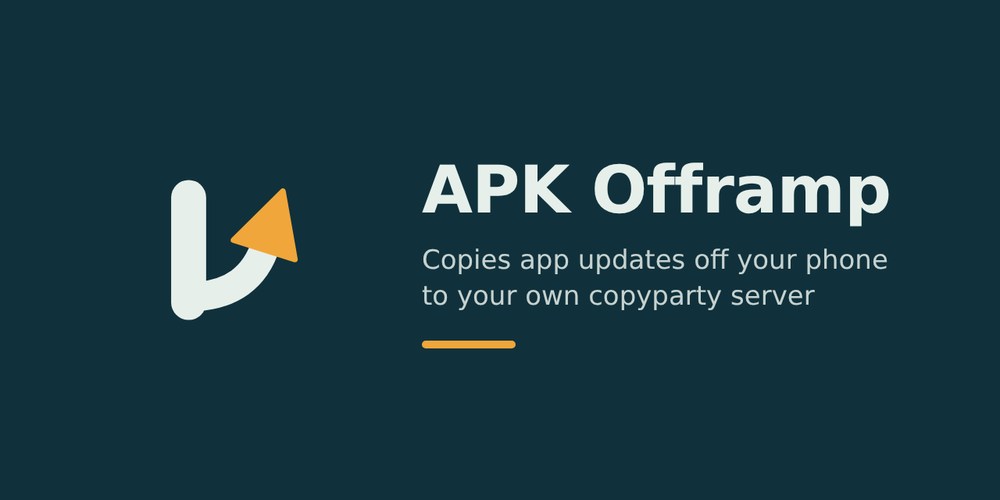

# APK Offramp



APK Offramp copies app updates off a phone that has Play Services and uploads them to your own copyparty server, so a second device without Play Services can install them with ObtainX or Obtainium. Designed with ObtainX in mind so behavior may be different in the upstream Obtainium.

It never talks to Google. The Play Store on your phone does the updating, and Offramp only reads the APK files that are already installed. No root, no Shizuku, no accessibility tricks.

## How it works

1. A sweep (every 30 minutes by default) or instant mode sees that a monitored app's version code went up.
2. Offramp waits until two reads 30 seconds apart agree, since Play installs splits in several steps.
3. It copies the base APK and any splits into its private cache and checks the copy.
4. A single APK stays as it is. Splits are zipped, untouched and uncompressed, into one `.apks`.
5. The file goes up to copyparty in chunks under a hidden name, then rotation moves the old version into `older/`, puts the new one in place, and prunes.
6. You get a notification with a Copy link button, and the app's detail screen lists every version kept on the server with its link.

On the server it looks like this:

```
https://files.example.com/apks/com.example.app/
├── com.example.app.apk                  current release, stable name
└── older/
    ├── com.example.app_2.5.0_1230.apk   versionName_versionCode
    └── com.example.app_2.4.9_1228.apk
```

Split apps get `com.example.app.apks` instead. The current file always keeps the same name, so ObtainX can watch one URL forever.

## What it talks to

Only the copyparty destinations you add. No Google APIs, no Play Services or Firebase libraries, no analytics, no crash reporting, no update checks.

## Prerequisites

- A source phone on Android 8.0 or newer, with the apps you bought.
- A target device with ObtainX and, for split apps, an installer that takes `.apks` (InstallerX or App Manager).
- A copyparty server you control, reachable from the source phone over HTTPS.
- A copyparty account with `r`, `w`, `m` and `d` on the destination folder. `.` is recommended. Details below.

## Install Offramp

1. Download `apkofframp-X.Y.Z.apk` and `apkofframp-X.Y.Z.apk.sha256` from the [Releases page](https://github.com/MZGSZM/APKOfframp/releases).
2. Check the download: `sha256sum -c apkofframp-X.Y.Z.apk.sha256`.
3. Check the signing certificate: `apksigner verify --print-certs apkofframp-X.Y.Z.apk`. The `SHA-256 digest` line must match:

   `Release certificate SHA-256: (add the digest here after the first signed release)`

4. On the phone, allow your browser or file manager to install unknown apps, since that is how sideloading works.
5. Open the APK and install it.

To keep Offramp itself updated, add `https://github.com/MZGSZM/APKOfframp` to ObtainX as a GitHub source. ObtainX picks up each new release from there.

## Set it up

1. Open Offramp, go to Settings, and tap **Add the default destination**.
2. Enter the base URL including the folder, such as `https://files.example.com/apks/`. Each app goes in a folder named after its package inside that.
3. Enter the password. copyparty wants the account password alone in the `PW` header, or `user:password` if your server runs with `--usernames`.
4. Set **Maximum request size** to whatever your reverse proxy allows. I use CrowdSec in front of mine, so in my case this is the proxy's body limit. It depends on your setup; 32 MiB is the default.
5. Tap **Test connection**. It writes, moves, lists and deletes a marker file and tells you which of `r w m d .` work, and whether hash verification works.
6. Tap **Test request size** to push one request of the maximum size through your proxy.
7. Under Notifications and battery, exempt Offramp from battery optimization, since Android otherwise delays sweeps for apps you rarely open.
8. Go back to Apps, tap **+**, and pick an app from the installed list or type its package ID.

Now Offramp checks your apps on its own, uploads each new version, and shows the links on each app's detail screen.

## copyparty setup

I run copyparty with one private volume for this. Something like:

```
copyparty -a zack:yourpassword -v /srv/apks:apks:rwmd.,zack -e2d
```

| Permission | Used for |
|---|---|
| `r` | Listing folders and checking file sizes |
| `w` | Uploading staged files, moving files into `older/` and into place |
| `m` | Moving files out of the main folder and out of staging |
| `d` | Pruning old versions, cleanup after Test connection |
| `.` | Seeing hidden staging files, so an interrupted rotation resumes instead of uploading again |

Rotation needs `r`, `w` and `m`, plus `d` unless versions kept is set to "all". If one is missing the app pauses and a notification names the letter. Fix it on the server, then tap **Re-test and resume** on the app.

`-e2d` turns on the file index. With it, Offramp confirms each upload by asking copyparty to find the file by its chunk hashes. Without it, Offramp falls back to comparing sizes.

KEEP THE FOLDER PRIVATE. It holds copies of paid apps, and a copied link works for anyone who can read that folder.

## Point ObtainX at an app

1. In ObtainX, add an app with the HTML source.
2. Use the app folder URL, such as `https://files.example.com/apks/com.example.app/`. The folder page lists only the current file, because `older/` shows up as a folder link.
3. For a split app, set the link filter to match `.apks`. The default filter only matches `.apk`.

How ObtainX should log in to a private folder (password in the URL, basic auth, or a header) is still an open question. Try it against your server.

## Settings

| Setting | Default |
|---|---|
| Sweep interval | 30 minutes (15 is the minimum Android allows) |
| Settle delay | 30 seconds |
| Wi-Fi only | On |
| Charging only | Off |
| Default versions kept | 3 |
| Instant mode | Off |
| Show system apps in the picker | Off |
| Theme | Follow system |
| Dynamic color | On (Android 12 and later) |

Instant mode keeps a permanent notification and reacts within seconds. It starts when you open the app or flip the switch, never at boot, so after a reboot the sweep covers things until you open Offramp again.

Each app can override the destination, the folder (relative to the destination URL), and how many older versions are kept.

## Build it yourself

Prerequisites: JDK 17 or newer (CI uses 21) and the Android SDK. Android Studio brings both. The build uses the Gradle wrapper, so nothing else.

1. `git clone https://github.com/MZGSZM/APKOfframp.git`
2. `cd APKOfframp`
3. `./gradlew :app:assembleDebug`, since the debug build signs with your local debug key and installs beside a release build (it gets a `.debug` suffix).
4. The APK is in `app/build/outputs/apk/debug/`.

### Tests

- `./gradlew :app:testDebugUnitTest` runs the JVM tests: version rules, package IDs, URLs and naming, the settle check with a fake clock, bundling, kept-version links, and end-to-end runs against a real copyparty.
- The copyparty tests start a throwaway server, so they need `pip install copyparty`. Without it they are skipped. Set `REQUIRE_COPYPARTY=1` to make them fail instead, which is what CI does. Set `COPYPARTY_PYTHON` if your Python is not `python3`.
- `./gradlew :app:connectedDebugAndroidTest` runs the instrumented tests on a device or emulator: channels, the Copy link action, Room, theming, and install/update/extract. The install test needs two builds of the test app pushed to the device; see `.github/workflows/emulator.yml` for the exact steps.

## Releases

GitHub Actions has three workflows:

- **CI** on every push and pull request: lint, unit tests (with copyparty), debug build. The debug APK is attached to the run.
- **Emulator tests** on pull requests and `main`: instrumented tests on an API 35 emulator with KVM.
- **Release** on a pushed tag like `v1.2.3`: builds the signed APK, checks its certificate, and publishes a GitHub Release with the APK and its `.sha256`.

The version name comes from the tag. The version code is `major * 1000000 + minor * 1000 + patch`, so it always goes up.

### One-time signing setup

1. Make the release keystore: `keytool -genkeypair -v -keystore offramp-release.jks -keyalg RSA -keysize 4096 -validity 10000 -alias offramp`
2. Back it up offline, along with both passwords, somewhere that is not GitHub.

   IF YOU LOSE THIS KEYSTORE, NOBODY CAN UPDATE OFFRAMP IN PLACE EVER AGAIN. Android refuses an update signed with a different key, so every install would have to be removed and reinstalled.

3. Get its certificate digest: `keytool -list -v -keystore offramp-release.jks -alias offramp` and copy the `SHA256:` line.
4. Encode it: `base64 < offramp-release.jks | tr -d '\n' > keystore.b64`
5. In the repository settings, add these secrets: `OFFRAMP_KEYSTORE_BASE64` (contents of `keystore.b64`), `OFFRAMP_KEYSTORE_PASSWORD`, `OFFRAMP_KEY_ALIAS` (`offramp` here), `OFFRAMP_KEY_PASSWORD`.
6. Add a repository variable `OFFRAMP_CERT_SHA256` with the digest from step 3. Colons and case do not matter.
7. Delete `keystore.b64`.
8. Tag and push: `git tag v0.1.0 && git push origin v0.1.0`.

The release job decodes the keystore into a temp file, deletes it after the build, and refuses to publish if the APK's certificate does not match `OFFRAMP_CERT_SHA256`. Only that job gets write access to the repository. Put the digest in the Install section above once you have it.

Dependabot opens weekly pull requests for Gradle dependencies and Actions, and CI has to pass on each before you merge.

## Where this build is careful, or differs from the design

- **Settle check placement.** It runs at the start of the upload job, after the network constraint is met, rather than before the job is queued. The result is the same: nothing is copied until two reads agree.
- **Checking the staged file.** copyparty's search mode does not return hidden files (checked against copyparty 1.20.26), so the staged upload is verified by up2k itself (the server checks every chunk hash and the final handshake reports nothing missing) plus its size in a `?ls&dots` listing. The search-mode hash check runs after the final move, where the file is visible.
- **Upload now on a version already there.** If the server already has identical bytes at the stable path, nothing is uploaded or rotated, and history records it as Skipped.
- **Split mismatch.** Splits copied from your phone fit your phone's CPU, screen density and language. On a very different target device an install can fail or miss resources.
- **Extraction.** Offramp reads `sourceDir` and `splitSourceDirs` with plain file reads. If an app's files cannot be read that way, it is marked failed with a clear message and not retried.

## Hand tests

These need your phone, your server or your GitHub account, so they cannot run in CI:

1. A real Play update with Offramp closed: detection, upload, the new link on the detail screen, and Copy link on the notification.
2. Overnight and after a reboot, with battery optimization on and then off, to see how late sweeps run.
3. The full path through your reverse proxy and CrowdSec: a large upload, rotation, both test buttons, and a permission removed on purpose to watch the app pause and resume.
4. On the target: ObtainX installs from the folder, and a split app's `.apks` installs through your installer. Also how ObtainX logs in to the private folder.
5. A tagged release: download, sideload, and check the signing digest against this README.
6. On Android 12 or later: change the wallpaper and toggle dark mode, and check the app follows.

## Project layout

```
app/src/main/java/com/mzgszm/apkofframp/
  core/          pure Kotlin: naming, URLs, up2k client, bundler, settle check, rotation (unit tested on the JVM)
  data/          Room tables, settings, Keystore-wrapped password
  system/        reading installed apps, extracting APKs
  work/          sweep, upload worker, instant mode, boot receiver
  notify/        channels, notifications, Copy link
  ui/            Compose screens and theme
testapp/         tiny app the emulator test installs at two versions
design/logo.svg  master logo; launcher and notification icons are generated from it
```
